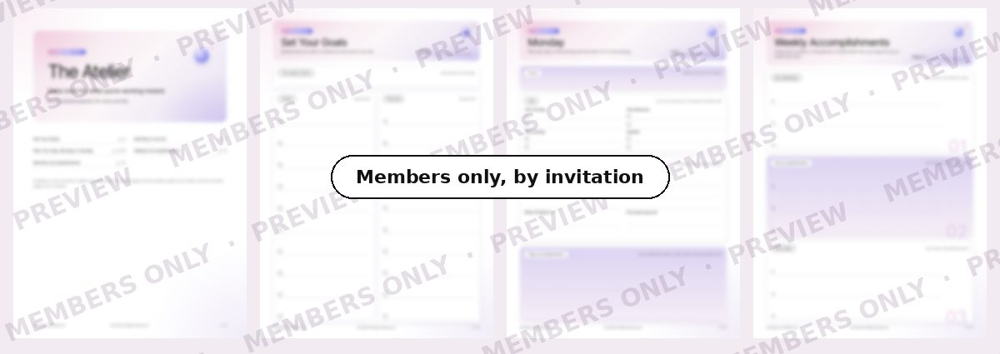

# The Atelier

*Plan what matters. Keep a record of what you achieve.* An AI-assisted planner by Weiwei Hu.

[Website](https://weiweihu.carrd.co/) · [LinkedIn](https://www.linkedin.com/in/weiweihu/) · [GitHub](https://github.com/wei-wei-hu/the-atelier)

An AI-assisted planner for work and life. Plan what matters, make progress on your goals, and keep track of what you accomplish along the way.

**See the page:** https://wei-wei-hu.github.io/the-atelier/

## Why I built The Atelier

- **Some days, you get so busy that the things you really wanted to do never make it onto your priority list. By the end of the week, you’re still trying to figure out what you got done.**
- **I created The Atelier to let AI help you decide what you want to achieve, plan your days, keep track of your progress, and review what you’ve accomplished and what to focus on next.**

## How The Atelier works

### Set Your Goals

Decide what you want to move forward at work and in your personal life. Choose your priorities for the week and make room for the skills you want to develop.

### Plan Your Day

Start with your three most important tasks. Use short check-ins to adjust your plans, record what you completed, and keep track of what still needs attention.

### Track Your Accomplishments

Let AI turn your daily notes into weekly accomplishment summaries. Each month, review your strongest examples, identify who should hear about them, and prepare for your next career conversation.

## See an example

- **Set Your Goals:** Open a small online candle shop, get the first 10 orders, and still walk or run four times a week.
- **Plan Your Day:** Wednesday’s focus: Open the shop. Publish it, post the launch on Instagram, and tell 10 friends.
- **Review your day:** 3 of 4 done. Still open: read 20 pages, by Thursday night.
- **Track Your Accomplishments:** “Shop is live! The Instagram post brought 3 orders on day one.” At the end of the week, it becomes a one-pager.

Weekly one-pager, ready to download as PDF or PowerPoint, or to be sent by email.

## Prefer pen and paper?

Membership includes a printable companion to capture your goals, daily plans, weekly wins, and monthly reflections along the way.

## Make room for what you're working toward.

The Atelier is currently available by invitation. Message me on LinkedIn and tell me a little about what you'd like to achieve.

**[Request an invitation →](https://www.linkedin.com/in/weiweihu/)**

## License

All rights reserved. No part of this repository may be copied, changed, shared, sold or used to train AI without written permission from Weiwei Hu. See [LICENSE](LICENSE) for the full terms.

---

Designed by Weiwei Hu · [Website](https://weiweihu.carrd.co/) · [LinkedIn](https://www.linkedin.com/in/weiweihu/) · © 2026 Weiwei Hu. All rights reserved.
