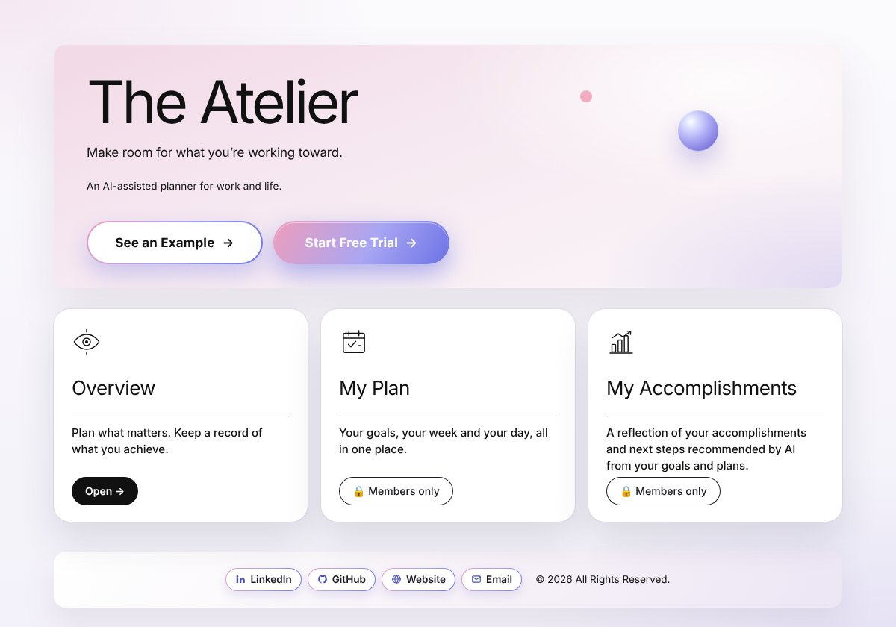
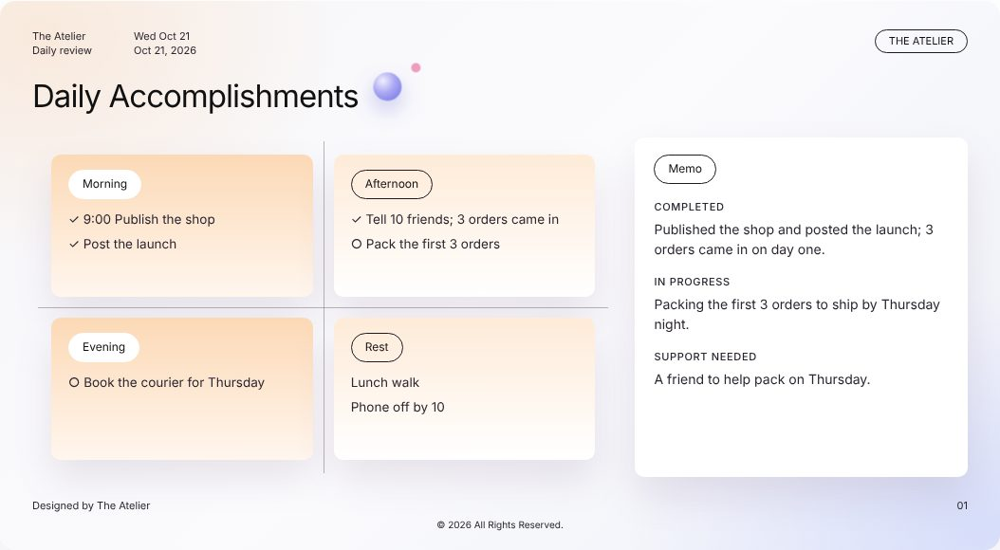
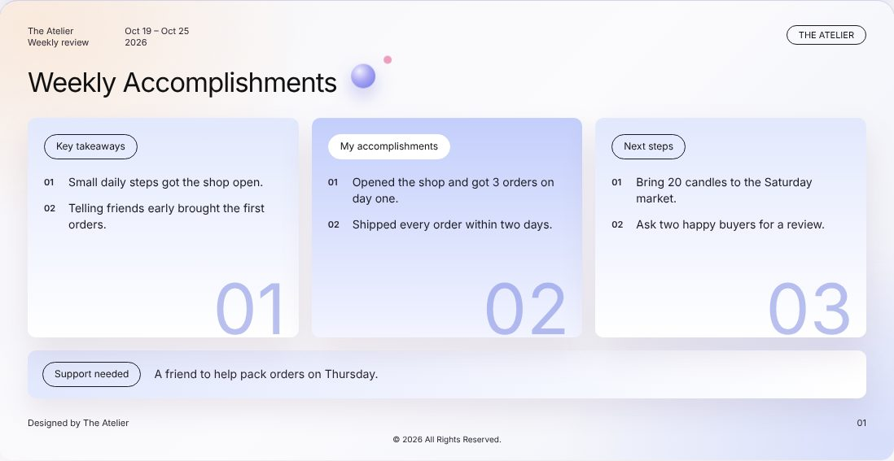
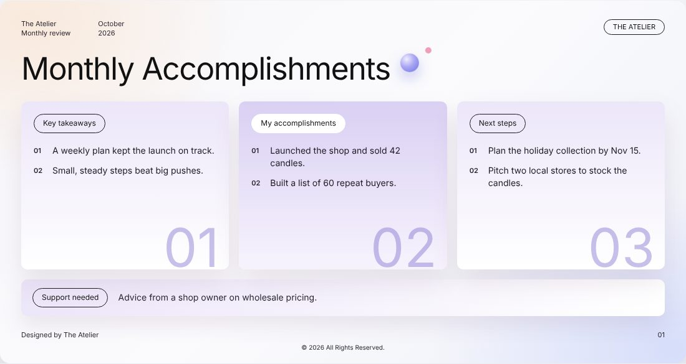

# The Atelier

*Make room for what you’re working toward.* An AI-assisted planner for work and life.

[Website](https://weiweihu.carrd.co/) · [LinkedIn](https://www.linkedin.com/in/weiweihu/) · [GitHub](https://github.com/wei-wei-hu/the-atelier)

An AI-assisted planner for work and life. Plan what matters, make progress on your goals, and keep track of what you accomplish along the way.

**See the page:** https://wei-wei-hu.github.io/the-atelier/

## Why I created The Atelier

- **Some days, you get so busy that the things you really wanted to do never make it onto your priority list. By the end of the week, you’re still trying to figure out what you got done.**
- **I created The Atelier to let AI help you decide what you want to achieve, plan your days, keep track of your progress, and review what you’ve accomplished and what to focus on next.**

## How The Atelier works

### Set My Week

Tell us a little about you, your goals for the week at work and in life, and the tasks and routines you come back to.

### Plan and Review My Day

Set today’s focus and plan your morning, afternoon and evening. At the end of the day, review it, note the support you need and prepare tomorrow.

### My Accomplishments

AI turns your days into daily, weekly and monthly accomplishments. Save them, and share them as PDF, PowerPoint or email for your next career conversation.

## What you get

1. **Every day:** AI drafts your Daily Accomplishments.
2. **Every week:** AI drafts your Weekly Accomplishments.
3. **Every month:** AI drafts your Monthly Accomplishments.

Share each one as a PDF, a PowerPoint slide or an email.

## Make room for what you're working toward.

The Atelier is currently available to members only. Message me on LinkedIn and tell me a little about what you’d like to achieve.

**[Start Free Trial →](https://wei-wei-hu.github.io/the-atelier/app/)**

## License

All rights reserved. No part of this repository may be copied, changed, shared, sold or used to train AI without written permission from Weiwei Hu. See [LICENSE](LICENSE) for the full terms.

---

Designed by Weiwei Hu · [Website](https://weiweihu.carrd.co/) · [LinkedIn](https://www.linkedin.com/in/weiweihu/) · © 2026 Weiwei Hu. All rights reserved.
